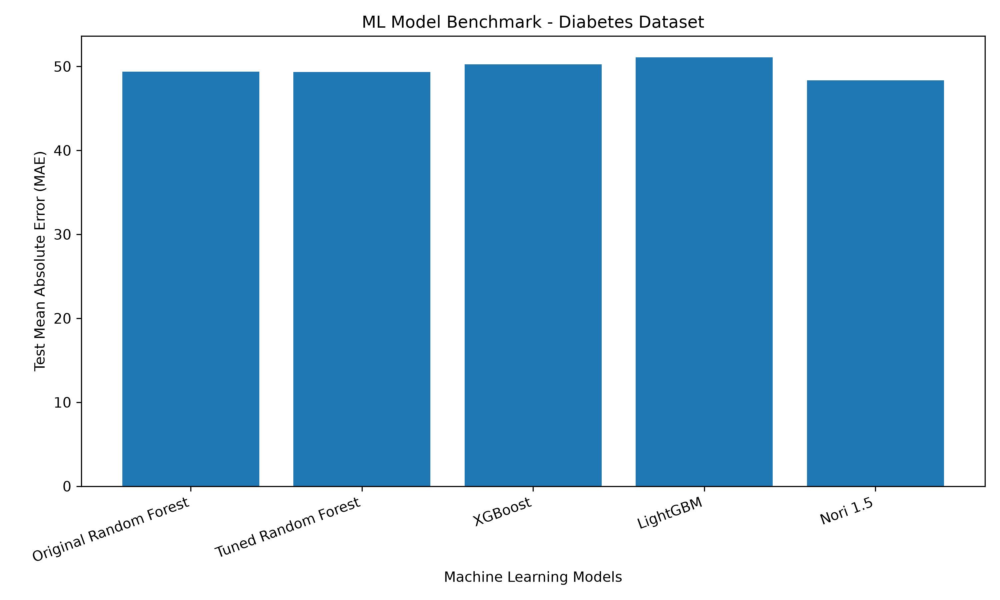

# Nori vs Traditional ML — Benchmark

## Overview
Benchmarking a pretrained tabular foundation model,
Synthefy Nori 1.5, against traditional regression models.

## Models Compared
- Random Forest
- Tuned Random Forest
- XGBoost
- LightGBM
- Synthefy Nori 1.5

## Dataset
- Scikit-learn Diabetes Regression Dataset
- Total samples: 442
- Training samples: 353
- Testing samples: 89
- Train/test split: 80/20
- Random state: 21
- Cross-validation: 5-fold KFold

## Results

| Model | CV MAE | Test MAE | Test R² |
|---|---:|---:|---:|
| Random Forest | 45.56 | 49.37 | 0.352 |
| Tuned Random Forest | 45.29 | 49.34 | 0.349 |
| XGBoost | 45.67 | 50.23 | 0.320 |
| LightGBM | 46.05 | 51.07 | 0.280 |
| Nori 1.5 | 44.43 | 48.34 | 0.406 |

## Benchmark Visualization

## Key Findings
Nori 1.5 achieved the lowest prediction error
in this experiment.

Results are based on a single held-out test split.
Further evaluation is needed before drawing
general performance conclusions.

## Project Files
- improve_models.py — Traditional ML models
- test_nori.py — Nori evaluation
- create_report.py — Results and chart generation
- benchmark_results.csv — Saved metrics
- benchmark_comparison.png — Comparison chart
